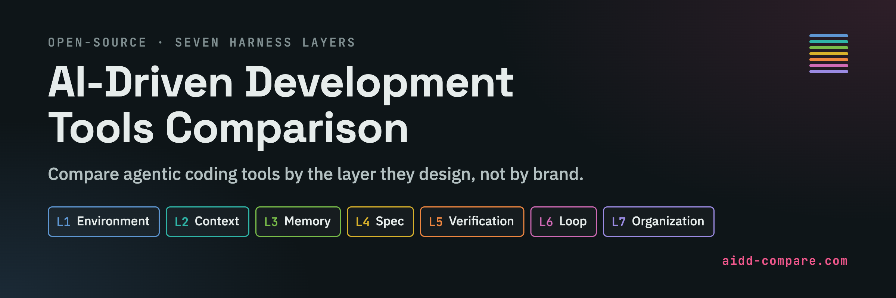

# AI-Driven Development Tools Comparison

An open comparison of open-source AI-driven development tools, organized into seven layers.

Compare what each tool supports, the artifacts it produces, and where it fits your project.

[Open the comparison(aidd-compare.com)](https://aidd-compare.com/) · [日本語](i18n/README.ja.md)

## Getting started

1. Browse the [comparison site](https://aidd-compare.com/) or the [comparison table](docs/comparison.md).
2. Use the [decision guide](docs/decision-guide.md) to find the layer that matches your problem.
3. Check each tool's prerequisites, project fit and reasons not to use it.

## Documentation

| Read | What it answers |
|---|---|
| [Comparison table](docs/comparison.md) | What does each tool do, and where does it fit? |
| [Layers](docs/layers/README.md) | Is the problem about environment, context, memory, specification, verification, iteration or coordination? |
| [Standards](docs/standards.md) | Which interface and packaging standards apply, and which editions are recorded? |
| [Evaluation axes](docs/schema.md) | What do the values mean? |
| [Quality rubric](docs/quality-rubric.md) | What evidence earns each quality grade? |
| [Flows](docs/flows.md) | In what order does each tool organize the work? |
| [Layer and lifecycle coverage](docs/heatmap.md) | Which development stages does each layer support? |
| [Threats and controls](docs/threat-map.md) | Which adoption risks need attention? |
| [Inclusion criteria](CRITERIA.md) | Which tools belong in this comparison? |

## Layer model

Tools are grouped by their primary layer. Follow each link for its full record, including secondary layers. The comparison also includes conventions and patterns.

<!-- tools-by-layer:start -->
| Layer | What it designs | Tools |
|---|---|---|
| [L1](docs/layers/L1.md) | Environment and tools | [agent-lsp](data/tools/blackwell-systems__agent-lsp.json), [Browser Use](data/tools/browser-use__browser-use.json), [gh-aw](data/tools/github__gh-aw.json), [Strands Agents](data/tools/strands-agents__harness-sdk.json) |
| [L2](docs/layers/L2.md) | Context | [.NET Agent Skills](data/tools/dotnet__skills.json), [Agentic Plugin Marketplace](data/tools/wshobson__agents.json), [AGENTS.md](data/tools/agentsmd__agents.md.json), [Claude Context](data/tools/zilliztech__claude-context.json), [CodeGraph](data/tools/colbymchenry__codegraph.json), [Context7](data/tools/upstash__context7.json), [Framelink Figma MCP](data/tools/glips__figma-context-mcp.json), [Headroom](data/tools/headroomlabs-ai__headroom.json), [LeanCTX](data/tools/yvgude__lean-ctx.json), [Repomix](data/tools/yamadashy__repomix.json), [RTK (Rust Token Killer)](data/tools/rtk-ai__rtk.json), [Serena](data/tools/oraios__serena.json), [skills CLI](data/tools/vercel-labs__skills.json), [Skills for Real Engineers](data/tools/mattpocock__skills.json), [snip](data/tools/edouard-claude__snip.json) |
| [L3](docs/layers/L3.md) | Memory | [Basic Memory](data/tools/basicmachines-co__basic-memory.json), [Beads](data/tools/gastownhall__beads.json), [Cognee](data/tools/topoteretes__cognee.json), [Graphiti](data/tools/getzep__graphiti.json), [Letta Code](data/tools/letta-ai__letta-code.json), [mem0](data/tools/mem0ai__mem0.json), [MemoryOS](data/tools/bai-lab__memoryos.json), [MemOS](data/tools/memtensor__memos.json), [MemPalace](data/tools/mempalace__mempalace.json), [OpenViking](data/tools/volcengine__openviking.json), [Supermemory](data/tools/supermemoryai__supermemory.json) |
| [L4](docs/layers/L4.md) | Specification | [AI-DLC Workflows](data/tools/awslabs__aidlc-workflows.json), [BMAD-METHOD](data/tools/bmad-code-org__bmad-method.json), [cc-sdd](data/tools/gotalab__cc-sdd.json), [DESIGN.md](data/tools/google-labs-code__design-md.json), [drawio-skill](data/tools/agents365-ai__drawio-skill.json), [GitHub Spec-Kit](data/tools/github__spec-kit.json), [GSD Core](data/tools/open-gsd__gsd-core.json), [MoAI-ADK](data/tools/modu-ai__moai-adk.json), [OpenSpec](data/tools/fission-ai__openspec.json), [Planning with Files](data/tools/othmanadi__planning-with-files.json), [PM Skills Marketplace](data/tools/phuryn__pm-skills.json), [Spec Kitty](data/tools/spec-kitty__spec-kitty.json), [Spec Workflow MCP](data/tools/pimzino__spec-workflow-mcp.json) |
| [L5](docs/layers/L5.md) | Verification | [Coze Loop](data/tools/coze-dev__coze-loop.json), [DeepEval](data/tools/confident-ai__deepeval.json), [hol-guard](data/tools/hashgraph-online__hol-guard.json), [Inspect AI](data/tools/ukgovernmentbeis__inspect_ai.json), [judgeval](data/tools/judgmentlabs__judgeval.json), [Langfuse](data/tools/langfuse__langfuse.json), [Opik](data/tools/comet-ml__opik.json), [promptfoo](data/tools/promptfoo__promptfoo.json), [Semgrep OSS](data/tools/semgrep__semgrep.json), [SkillSpector](data/tools/nvidia__skillspector.json), [Strix](data/tools/usestrix__strix.json), [TDD Guard](data/tools/nizos__tdd-guard.json) |
| [L6](docs/layers/L6.md) | Loop | [DeerFlow](data/tools/bytedance__deer-flow.json), [Loop Engineering](data/tools/cobusgreyling__loop-engineering.json), [Open Ralph Wiggum](data/tools/th0rgal__open-ralph-wiggum.json), [Ralph for Claude Code](data/tools/frankbria__ralph-claude-code.json), [Ralph Loop (pattern)](data/tools/ghuntley.com__ralph.json), [Superpowers](data/tools/obra__superpowers.json) |
| [L7](docs/layers/L7.md) | Coordination | [AG-UI](data/tools/ag-ui-protocol__ag-ui.json), [CLI Agent Orchestrator (CAO)](data/tools/awslabs__cli-agent-orchestrator.json), [container-use](data/tools/dagger__container-use.json), [CrewAI](data/tools/crewaiinc__crewai.json), [Nimbalyst](data/tools/nimbalyst__nimbalyst.json), [Orca](data/tools/stablyai__orca.json), [Ruflo](data/tools/ruvnet__ruflo.json), [Swarms](data/tools/kyegomez__swarms.json) |
<!-- tools-by-layer:end -->

## Evaluation axes

Compare lifecycle support, project fit, quality, token profile, maintenance, workflow and standards support. Security controls and interface capabilities are separate dimensions. [Definitions and field meanings](docs/schema.md) explain how to interpret each value.

## How the comparison works

Each [tool record](data/tools/) contains sources, access dates, prerequisites, anti-fit conditions and assessment values. [Flow evidence](data/flow-evidence/) connects steps to their source files. [Project health](docs/health.md) provides context for maintenance and distribution.

`none` means examined and absent; `not-assessed` means not examined. `conf: check` and `unresolved` identify assessments requiring verification. A documented capability is not the same as an implemented control. Token profiles describe structure; they are not measured costs. Stars indicate attention, not quality.

There is no total score or best-tool ranking. Compare the dimensions that matter to your project. The source dates describe when facts were checked; they are not live measurements.

For data reuse, see the [field guide](docs/schema.md). To report an error or suggest a tool, see [CONTRIBUTING](CONTRIBUTING.md). Original documents and data are licensed under [CC BY 4.0](LICENSE), excluding third-party material. When citing assessments, we recommend including the version or commit and your access date.
