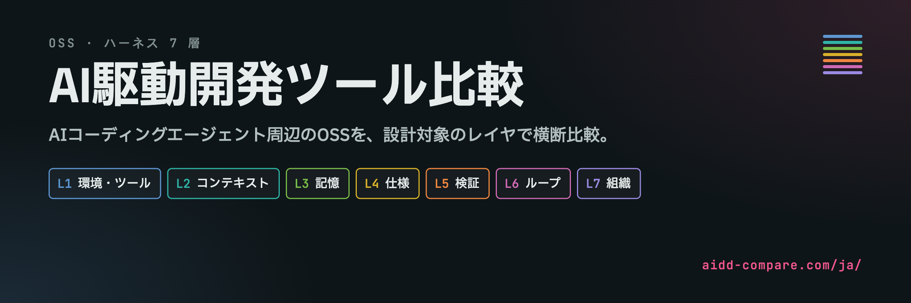

# AI駆動開発ツール比較

オープンソースのAI駆動開発ツールを7つのレイヤで整理した比較資料です。

各ツールが支援する工程、残す成果物、プロジェクトへの適合を比較できます。

[比較サイトを開く（aidd-compare.com）](https://aidd-compare.com/ja/) · [English](../README.md)

## はじめに

1. [比較サイト](https://aidd-compare.com/ja/)か[比較表](../docs/comparison.md)でツールを一覧します。
2. [選定ガイド](../docs/decision-guide.md)で課題を整理し、対応するレイヤを探します。
3. 各ツールの導入条件、プロジェクトへの適合、向かない用途を確認します。

## ドキュメント

詳細資料は英語です。

| 読む資料 | 分かること |
|---|---|
| [比較表](../docs/comparison.md) | 各ツールの役割と適用範囲 |
| [レイヤの説明](../docs/layers/README.md) | 実行環境、コンテキスト、記憶、仕様、検証、反復、協調の違い |
| [標準](../docs/standards.md) | インターフェースとパッケージの標準、掲載している版 |
| [評価軸とデータの読み方](../docs/schema.md) | 各項目と値の意味 |
| [品質の評価基準](../docs/quality-rubric.md) | 評価に必要な根拠 |
| [作業フロー](../docs/flows.md) | ツールが定める作業の順序 |
| [掲載基準](../CRITERIA.md) | 比較に含めるツールの範囲 |

## レイヤモデル

主レイヤで分類しています。副レイヤを含む詳細は各リンク先で確認できます。比較対象の規約やパターンも含みます。

<!-- tools-by-layer:start -->
| レイヤ | 設計するもの | ツール |
|---|---|---|
| [L1](../docs/layers/L1.md) | エージェントの実行環境と使えるツール | [agent-lsp](../data/tools/blackwell-systems__agent-lsp.json), [Browser Use](../data/tools/browser-use__browser-use.json), [gh-aw](../data/tools/github__gh-aw.json), [Strands Agents](../data/tools/strands-agents__harness-sdk.json) |
| [L2](../docs/layers/L2.md) | 推論に渡すコンテキスト | [.NET Agent Skills](../data/tools/dotnet__skills.json), [Agentic Plugin Marketplace](../data/tools/wshobson__agents.json), [AGENTS.md](../data/tools/agentsmd__agents.md.json), [Claude Context](../data/tools/zilliztech__claude-context.json), [CodeGraph](../data/tools/colbymchenry__codegraph.json), [Context7](../data/tools/upstash__context7.json), [Framelink Figma MCP](../data/tools/glips__figma-context-mcp.json), [Headroom](../data/tools/headroomlabs-ai__headroom.json), [LeanCTX](../data/tools/yvgude__lean-ctx.json), [Repomix](../data/tools/yamadashy__repomix.json), [RTK (Rust Token Killer)](../data/tools/rtk-ai__rtk.json), [Serena](../data/tools/oraios__serena.json), [skills CLI](../data/tools/vercel-labs__skills.json), [Skills for Real Engineers](../data/tools/mattpocock__skills.json), [snip](../data/tools/edouard-claude__snip.json) |
| [L3](../docs/layers/L3.md) | ターンやセッションを越えて残す記憶 | [Basic Memory](../data/tools/basicmachines-co__basic-memory.json), [Beads](../data/tools/gastownhall__beads.json), [Cognee](../data/tools/topoteretes__cognee.json), [Graphiti](../data/tools/getzep__graphiti.json), [Letta Code](../data/tools/letta-ai__letta-code.json), [mem0](../data/tools/mem0ai__mem0.json), [MemoryOS](../data/tools/bai-lab__memoryos.json), [MemOS](../data/tools/memtensor__memos.json), [MemPalace](../data/tools/mempalace__mempalace.json), [OpenViking](../data/tools/volcengine__openviking.json), [Supermemory](../data/tools/supermemoryai__supermemory.json) |
| [L4](../docs/layers/L4.md) | 実装する変更の仕様 | [AI-DLC Workflows](../data/tools/awslabs__aidlc-workflows.json), [BMAD-METHOD](../data/tools/bmad-code-org__bmad-method.json), [cc-sdd](../data/tools/gotalab__cc-sdd.json), [DESIGN.md](../data/tools/google-labs-code__design-md.json), [drawio-skill](../data/tools/agents365-ai__drawio-skill.json), [GitHub Spec-Kit](../data/tools/github__spec-kit.json), [GSD Core](../data/tools/open-gsd__gsd-core.json), [MoAI-ADK](../data/tools/modu-ai__moai-adk.json), [OpenSpec](../data/tools/fission-ai__openspec.json), [Planning with Files](../data/tools/othmanadi__planning-with-files.json), [PM Skills Marketplace](../data/tools/phuryn__pm-skills.json), [Spec Kitty](../data/tools/spec-kitty__spec-kitty.json), [Spec Workflow MCP](../data/tools/pimzino__spec-workflow-mcp.json) |
| [L5](../docs/layers/L5.md) | 検証方法と完了条件 | [Coze Loop](../data/tools/coze-dev__coze-loop.json), [DeepEval](../data/tools/confident-ai__deepeval.json), [hol-guard](../data/tools/hashgraph-online__hol-guard.json), [Inspect AI](../data/tools/ukgovernmentbeis__inspect_ai.json), [judgeval](../data/tools/judgmentlabs__judgeval.json), [Langfuse](../data/tools/langfuse__langfuse.json), [Opik](../data/tools/comet-ml__opik.json), [promptfoo](../data/tools/promptfoo__promptfoo.json), [Semgrep OSS](../data/tools/semgrep__semgrep.json), [SkillSpector](../data/tools/nvidia__skillspector.json), [Strix](../data/tools/usestrix__strix.json), [TDD Guard](../data/tools/nizos__tdd-guard.json) |
| [L6](../docs/layers/L6.md) | 反復、フィードバック、停止条件 | [DeerFlow](../data/tools/bytedance__deer-flow.json), [Loop Engineering](../data/tools/cobusgreyling__loop-engineering.json), [Open Ralph Wiggum](../data/tools/th0rgal__open-ralph-wiggum.json), [Ralph for Claude Code](../data/tools/frankbria__ralph-claude-code.json), [Ralph Loop（パターン）](../data/tools/ghuntley.com__ralph.json), [Superpowers](../data/tools/obra__superpowers.json) |
| [L7](../docs/layers/L7.md) | 複数エージェントの役割分担と協調 | [AG-UI](../data/tools/ag-ui-protocol__ag-ui.json), [CLI Agent Orchestrator (CAO)](../data/tools/awslabs__cli-agent-orchestrator.json), [container-use](../data/tools/dagger__container-use.json), [CrewAI](../data/tools/crewaiinc__crewai.json), [Nimbalyst](../data/tools/nimbalyst__nimbalyst.json), [Orca](../data/tools/stablyai__orca.json), [Ruflo](../data/tools/ruvnet__ruflo.json), [Swarms](../data/tools/kyegomez__swarms.json) |
<!-- tools-by-layer:end -->

## 評価軸

開発工程の支援範囲、プロジェクトへの適合、品質、トークン消費の傾向、保守状況、作業フロー、標準への対応を比較します。[評価軸とデータの読み方](../docs/schema.md)で各値の意味を確認できます。

## 比較方法

[ツール別データ](../data/tools/)には、出典、参照日、前提条件、向かない用途を記載しています。[フローの根拠](../data/flow-evidence/)では、各手順に対応する参照先を確認できます。

`none`は確認した結果の「なし」、`not-assessed`は「未確認」です。`conf: check`と`unresolved`は再確認が必要な評価を示します。トークン消費の分類は構造からの判断で、実測費用ではありません。スター数も品質の点数ではありません。

総合点や順位は付けていません。自分の課題に関係する項目を比較してください。出典の参照日は確認時点を示し、値が常に最新であることを意味しません。

誤りの指摘や掲載の提案は[CONTRIBUTING](../CONTRIBUTING.md)を参照してください。

独自に作成した資料とデータは[CC BY 4.0](../LICENSE)で公開しています。第三者の素材は対象外です。評価を引用する際は、版またはコミットと参照日の併記をおすすめします。
